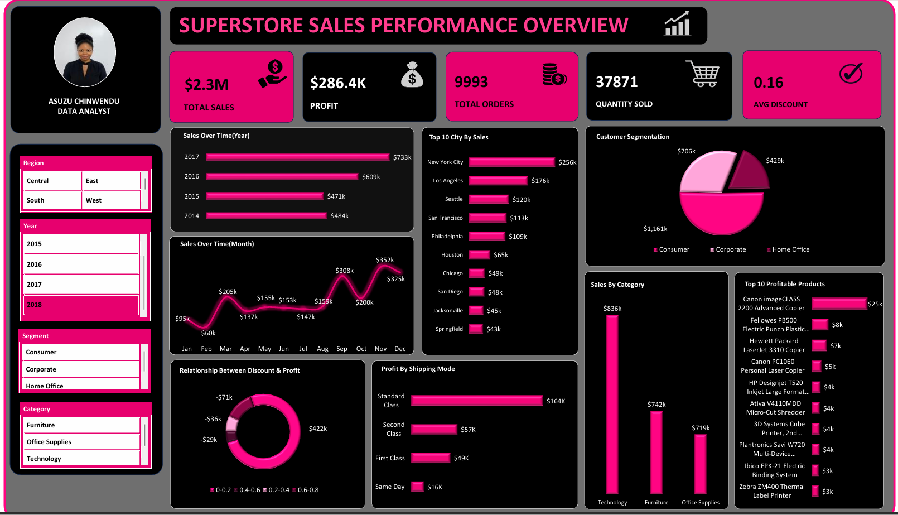

# Superstore Sales Performance Dashboard

## Project Overview

The **Superstore Sales Performance Dashboard** is an interactive data visualization project designed to analyze sales performance, profitability, customer segments, product categories, and shipping methods.

The dashboard transforms Superstore sales data into meaningful business insights, helping stakeholders monitor key performance indicators (KPIs), identify sales trends, and make data-driven decisions.

## Dashboard Preview

## Project Objectives

- Monitor overall sales, profit, order volume, and quantity sold.
- Analyze yearly and monthly sales trends.
- Identify top-performing cities by sales.
- Understand sales distribution across customer segments.
- Evaluate performance across product categories.
- Identify the most profitable products.
- Examine the relationship between discounts and profitability.
- Compare profitability across shipping methods.
- Enable interactive analysis using filters for region, year, segment, and category.

## Key Performance Indicators (KPIs)

| KPI | Value | Description |
|---|---:|---|
| Total Sales | $2.3M | Overall sales revenue |
| Total Profit | $286.4K | Total profit earned |
| Total Orders | 9,993 | Number of orders recorded |
| Quantity Sold | 37,871 | Total units sold |
| Average Discount | 0.16 | Average discount value shown in the dashboard |

## Dashboard Features

### 1. Sales Over Time — Yearly Analysis

Analyzes annual sales performance to identify changes in revenue over time and compare yearly results.

### 2. Sales Over Time — Monthly Analysis

Visualizes monthly sales trends to highlight seasonal patterns, sales peaks, and periods of lower performance.

### 3. Top 10 Cities by Sales

Ranks cities by total sales, helping identify major geographical markets and potential opportunities for expansion.

### 4. Customer Segmentation

Displays sales distribution across three customer segments:

- Consumer
- Corporate
- Home Office

This helps evaluate each segment's contribution to overall revenue.

### 5. Sales by Category

Compares sales performance across the major product categories:

- Technology
- Furniture
- Office Supplies

This helps identify the categories contributing most to revenue.

### 6. Top 10 Profitable Products

Highlights products with the highest profits, supporting product-level performance evaluation and inventory decisions.

### 7. Relationship Between Discount and Profit

Examines profitability across discount ranges to help assess how discounting may relate to profit and loss.

### 8. Profit by Shipping Mode

Compares profit across shipping methods:

- Standard Class
- Second Class
- First Class
- Same Day

This helps evaluate profitability across delivery options.

## Interactive Filters

The dashboard includes slicers that allow users to filter the analysis by:

- **Region:** Central, East, South, and West
- **Year:** 2015, 2016, 2017, and 2018
- **Segment:** Consumer, Corporate, and Home Office
- **Category:** Furniture, Office Supplies, and Technology

These filters make it possible to explore specific business areas and compare performance across dimensions.

## Key Business Questions

This dashboard is designed to answer questions such as:

1. How does sales performance change over time?
2. Which cities generate the highest sales?
3. Which customer segment contributes most to sales?
4. Which product category generates the most revenue?
5. Which products are the most profitable?
6. How do discounts relate to profit and loss?
7. Which shipping mode generates the highest profit?
8. How does business performance vary by region and year?

## Tools and Technologies

Update this section to reflect the tools actually used to build the dashboard.

- **Dashboarding:** Microsoft Excel
- **Data Analysis:** KPI calculation, trend analysis, profitability analysis, and performance comparisons
- **Data Visualization:** Charts, KPI cards, and interactive filters
- **Business Intelligence:** Turning sales data into actionable insights

## How to Use

1. Clone or download this repository.
2. Open `Superstore_Performance_Analysis.png` to view the dashboard preview.
3. If included, open the original dashboard file in the application used to create it.
4. Use the interactive filters in the original dashboard to explore performance by region, year, customer segment, and category.
5. Review the visualizations to investigate trends and potential business opportunities.

## Business Value

This project demonstrates how data visualization can support business decision-making by:

- Tracking key sales and profitability metrics.
- Identifying high-performing products, cities, and categories.
- Understanding customer segment contributions.
- Evaluating discounting and shipping profitability.
- Supporting evidence-based sales and operational strategies.

## About the Analyst

**Asuzu Chinwendu | Data Analyst**

This project showcases an interest in data analytics, business intelligence, and transforming data into meaningful insights that support informed decision-making.

## Conclusion

The Superstore Sales Performance Dashboard provides a consolidated view of business performance through visualizations and key metrics. It helps stakeholders explore sales trends, assess profitability, compare customer segments, and identify potential opportunities for business growth.

---

If you find this project useful, feel free to ⭐ the repository!
